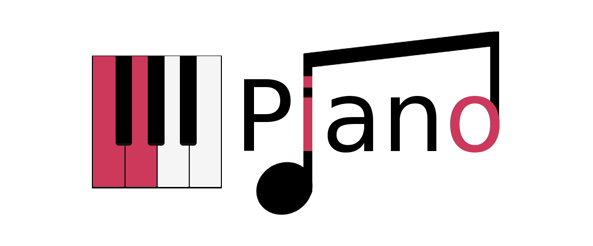

<h2 align="center">View scales and chords</h2>
<p align="center">
  <a href="https://github.com/stromland/piano/actions/workflows/deploy-github-pages.yml">
    
  </a>
  <a href="https://github.com/stromland/piano/actions/workflows/build-workspaces.yml">
    
  </a>
</p>

<h1 align="center">
  <a href="https://stromland.github.io/piano/">
    Demo
  </a>
</h1>

Pick a root note and a scale to see it on the keyboard, or switch to chords to
see the triads of that scale and their inversions. Notes are spelled the way
the key calls for: E♭ major has flats, E major has sharps.

In progression mode, enter a sequence of triads and seventh chords and the app
picks the inversion of each one so the left hand moves as little as possible
from chord to chord, then lets you step through them on the keyboard.

## Packages

| Package                           | What it is                                                                  |
| --------------------------------- | --------------------------------------------------------------------------- |
| [`piano-lib`](packages/piano-lib) | The music theory – scales, chords and keyboard layout – as plain functions. |
| [`piano-vue`](packages/piano-vue) | The web app, built with Vue and Vite.                                       |

## Development

Requires Node.js 22.13 or newer.

```sh
npm install
npm run dev
```

The app uses the source of `piano-lib` directly, so changes to the library
show up right away and nothing has to be built first.

| Command             | What it does                                         |
| ------------------- | ---------------------------------------------------- |
| `npm run dev`       | Starts the app at http://localhost:5173/piano/       |
| `npm test`          | Runs the tests of both packages                      |
| `npm run lint`      | Lints everything with ESLint                         |
| `npm run format`    | Formats everything with Prettier                     |
| `npm run typecheck` | Type-checks both packages                            |
| `npm run build`     | Builds the library and the app                       |
| `npm run preview`   | Serves the built app at http://localhost:5050/piano/ |
| `npm run check`     | Everything CI runs                                   |

## Releasing

```sh
scripts/release.sh minor
git push && git push origin v0.5.0
```

The script bumps the version of every package, commits and tags. Pushing the
tag deploys the app to GitHub Pages.
